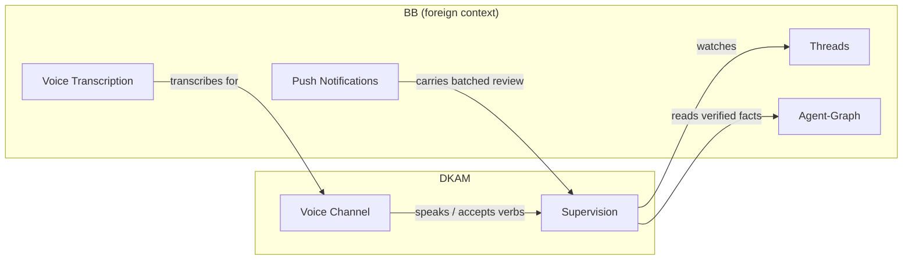

# Domain Model — L1 (prose glossary)

DKAM keeps an agent aligned with an operator who is away from every screen and
who will not come back to a desk to unblock it. The language below is how we
talk about the domain. Diagrams here are conceptual groupings only; formal ERDs
and invariants live at
[domain-architecture/DOMAIN-MODEL-L2.md](domain-architecture/DOMAIN-MODEL-L2.md).

The design decisions behind this glossary are in
[adr/0002-constraint-set-over-model-judged-drift.md](adr/0002-constraint-set-over-model-judged-drift.md).

## Bounded contexts (conceptual)

- **Supervision** — the core of DKAM: checking a working thread's turn against
  a declared constraint set, recording assumptions, parking unresolved items.
- **Voice Channel** — everything the operator hears and says. Delivery and
  capture, not judgment.

## Ubiquitous language (L1)

- **Operator** — the human running the work. Away from a screen, or at a desk
  later. Never required at a keyboard for a run to continue.
- **Working thread** — an ordinary BB thread doing the work, muted to the
  operator. DKAM supervises it; it never supervises itself.
- **Run** — one stretch of unattended working-thread activity. A run ends when
  the operator stops it, when a hard invariant is hit, or when it parks.
- **Constraint set** — the operator's declared rules for a working thread, held
  in order and checked mechanically. Replaces a prose statement of intent,
  because a program can check a rule and cannot check a paragraph.
- **Rule** — one constraint with an id, a check kind, a payload, and a one-word
  fix. Check kinds are: banned terms, required terms, declared value, path
  prohibition, required artifact, spend ceiling, test status.
- **Rule violation** — a rule whose mechanical check failed. The only thing DKAM
  ever calls an alert. A model never decides one.
- **Fix verb** — the single spoken word that applies a rule's remedy, for
  example "valueflows" to swap banned household vocabulary.
- **Verified fact** — a value read from the environment rather than inferred:
  test exit status, files touched, wall minutes, cumulative spend, whether the
  agent is waiting on input. Facts are the only other thing DKAM speaks.
- **Assumption** — a decision no rule covered. The agent states the default it
  took, in one sentence, and continues. An assumption never blocks a run.
- **Assumption ledger** — the ordered record of assumptions for a run. Counted
  aloud at review; read in one batch, never one at a time during a run.
- **Parked run** — a run that reached a safe step with an unanswered violation
  and is holding. It resumes on any later operator input, at any hour. Parking
  is not failure and not a timeout.
- **Safe step** — a point where a run can hold without leaving the workspace
  inconsistent: a completed tool call, a committed worktree step, a finished
  turn boundary.
- **Voice verb** — one word from a fixed vocabulary: `stop`, `status`,
  `decisions`, `park`, `resume`, `quiet`. Fixed because a walking operator can
  reliably produce one word and nothing else.
- **Hard invariant** — an action the run may not take unattended regardless of
  rules: no merge to a trunk branch, no push to a trunk branch, no deletion
  outside a rule's declared allowance.
- **Episode boundary** — a managed transition at the configured run length where
  the run checks its own state before continuing. A boundary is a checkpoint,
  not a failure and not a timeout.

## Business rules (natural language)

1. DKAM never narrates agent output. It speaks verified facts and rule
   violations, one line each, and nothing else.
2. A rule violation is always produced by a mechanical check. No model
   participates in deciding one.
3. An uncovered decision becomes a stated assumption and the run continues.
   DKAM never routes work back to a desk to be unblocked.
4. An unanswered violation parks the run at the next safe step. It never sits at
   a permission prompt and never waits for a keyboard.
5. Spoken alerts carry a rule id and a one-word fix, because a name is
   speakable while walking and an argument is not.
6. The operator's attention is the scarcest resource. An alert that has no fix
   verb is not an alert; it is a ledger entry.

## Avoid

- Do not call the constraint set an intent anchor, and do not call a rule
  violation drift. A constraint set is checked; drift is a conclusion, and DKAM
  does not draw conclusions.
- Do not use "alert" and "notification" interchangeably: an alert is a spoken
  rule violation with a fix verb; anything unspeakable is a ledger entry or a
  push notification.
- Do not say "timeout" for an episode boundary or a park. Both are managed
  transitions.
- Do not describe DKAM as a metacognitive layer. It is a checker and a
  transport.

## Vocabulary stability

Ephemeral or exploratory decisions do not live here; they go in [adr/](adr/).
Half-formed ideas go in [musings/](musings/).
